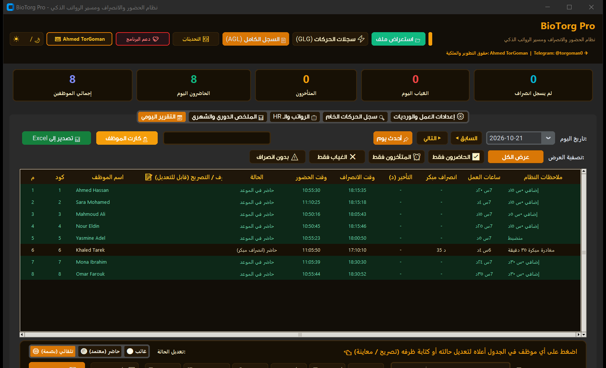
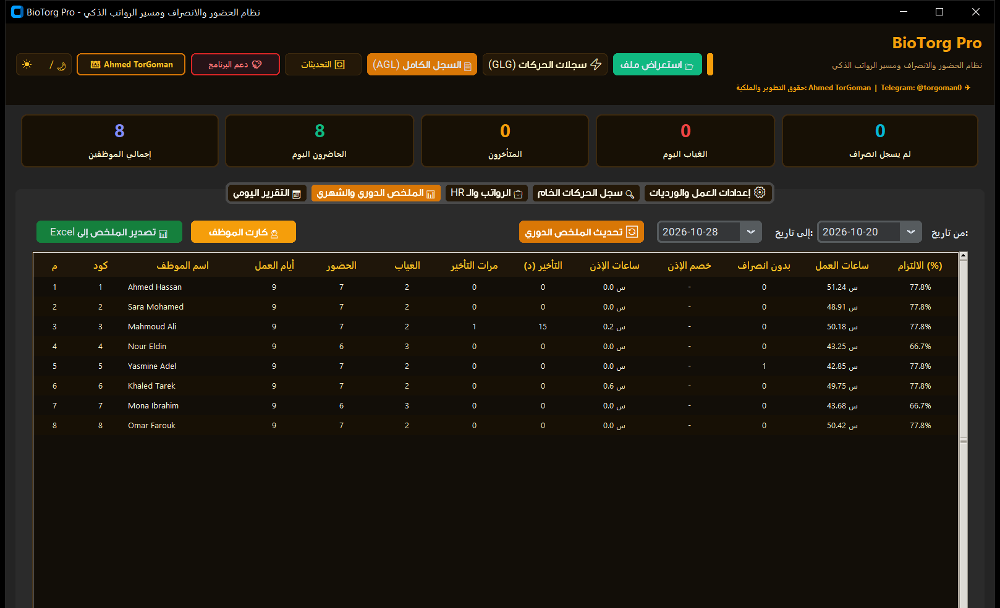
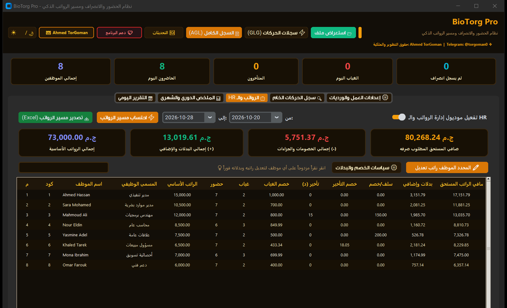
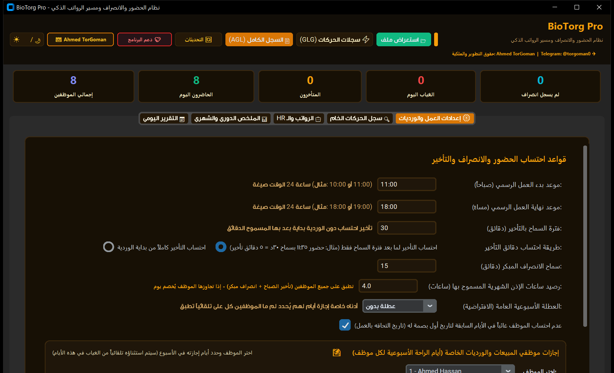
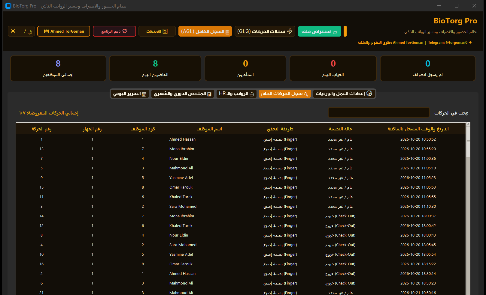
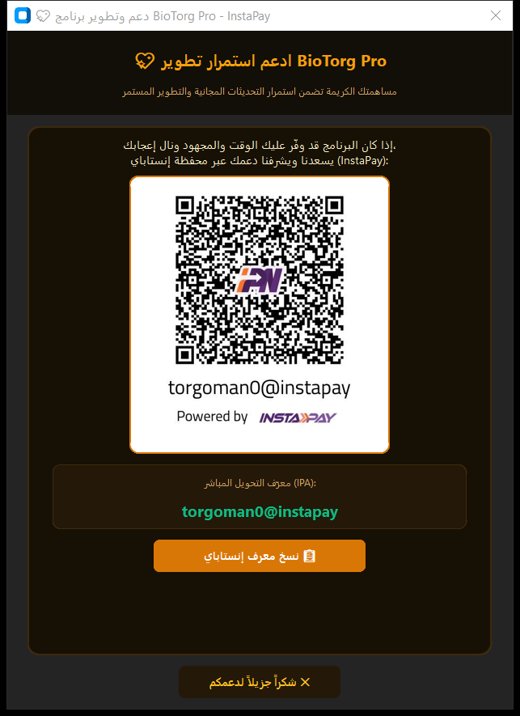

# 🌟 BioTorg Pro - الدليل التعريفي الشامل وكتالوج المميزات

# 🏢 BioTorg Pro
### نظام إدارة البصمة الذكي، الحضور والانصراف، ومسير الرواتب فائق السرعة
**الإصدار:** v2.2.1 &nbsp;|&nbsp; **المطور:** Ahmed TorGoman &nbsp;|&nbsp; ✈️ **تلجرام:** [@torgoman0](https://t.me/torgoman0) &nbsp;|&nbsp; **نظام التشغيل:** Windows 10 / 11

---

## 📖 نظرة عامة على النظام
برنامج **BioTorg Pro** هو نظام مكتبي متكامل مصمم خصيصاً للشركات والمؤسسات لإدارة وتدقيق بصمات الموظفين ومعالجة ملفات أجهزة الحضور والانصراف (Advision, Realand, ZKTeco) وحساب مسير الرواتب ومتابعة الغياب والتأخير وساعات الاستئذان بدقة رياضية متناهية وسرعة فائقة.

---

## 🖼️ جولة مصورة في صفحات البرنامج (Screenshots Showcase)

> **ملاحظة:** جميع الصور المرفقة أدناه حقيقية ومأخوذة مباشرة من شاشات البرنامج باستخدام **بيانات تجريبية نموذجية وهمية** لأغراض العرض والشرح دون كشف أي بيانات شخصية.

---

### 1️⃣ لوحة المتابعة اليومية وإحصائيات الحضور (Daily Attendance Dashboard)

* **ما تقدمه هذه الشاشة:**
  - **شريط الـ KPIs الإحصائي الذكي:** يعرض فوراً وفي رأس الصفحة:
    - 👥 **إجمالي الموظفين:** العدد الكلي للموظفين المسجلين.
    - 🟢 **الحاضرون اليوم:** عدد ونسبة الحضور الفعلي.
    - 🟡 **المتأخرون:** الموظفون الذين تجاوزوا موعد الوردية وفترة السماح.
    - 🔴 **الغياب اليوم:** من لم تسجل لهم أي بصمة خلال اليوم.
    - 🔵 **لم يسجل انصراف:** من سجلوا حضوراً ونسوا تسجيل الانصراف.
  - **فلاتر سريعة بنقرة واحدة:** إمكانية فرز الجدول بضغطة زر لعرض (الكل - الحاضرون - المتأخرون - الغياب - بدون انصراف).
  - **شريط بحث ديناميكي:** للوصول الفوري لأي موظف بالاسم أو برقم الكود (EnNo).
  - **زر التعديل الإداري:** لتسجيل الظروف الخاصة والمأموريات الخارجية لأي موظف بنقرة زر.

---

### 2️⃣ السجل الشهري التراكمي وساعات الاستئذان (Monthly Summary & Permission Hours)

* **ما تقدمه هذه الشاشة:**
  - **كشف الحساب التراكمي:** ملخص كامل لكل موظف على مدار الشهر (أيام العمل الفعلية، أيام الحضور، أيام الغياب، إجمالي دقائق التأخير).
  - **نظام ساعات الاستئذان الموحدة (جديد):** احتساب تراكمي دقيق لساعات الإذن المسموحة شهرياً، مع إظهار المتبقي والمستهلك والتنبيه الفوري في حال تجاوز الرصيد المسموح به.
  - **تصدير كشف الحضور Excel:** زر مباشر لتصدير تقرير إكسل شهري احترافي بتنسيق وألوان جذابة ومطابقة للتقارير الرسمية.

---

### 3️⃣ محرك الـ HR ومسير الرواتب فائق السرعة (HR & Payroll Engine)

* **ما تقدمه هذه الشاشة:**
  - **حسابات فورية في أجزاء من الثانية:** بفضل المحرك المطور والخيوط الخلفية الموازية، يتم احتساب مستحقات مئات الموظفين في أقل من 0.35 ثانية وبدون أي تهنيج للواجهة.
  - **تفصيل مالي دقيق:**
    - الراتب الأساسي والبدلات والمكافآت الإضافية.
    - خصم الغياب بناءً على معامل جزاء الغياب المعتمد.
    - خصم التأخير الصباحي والانصراف المبكر (سواء بالدقيقة أو بنظام الشرائح).
    - احتساب أجر الساعات الإضافية (Overtime).
    - **صافي الراتب المستحق النهائي (Net Salary)** بشكل مبرز وواضح.
  - **تصدير شيت الرواتب:** استخراج مسير رواتب Excel متكامل وجاهز للطباعة والاعتماد المالي.

---

### 4️⃣ إعدادات العمل والورديات والجزاءات (Shift & Attendance Settings)

* **ما تقدمه هذه الشاشة:**
  - **توقيت الوردية:** تحديد وقت بدء العمل ووقت الانتهاء.
  - **فترات السماح:** تحديد دقائق السماح بالتأخير الصباحي وسماح الانصراف المبكر.
  - **ساعات الاستئذان الشهرية:** تحديد رصيد الإذن العام لكافة الموظفين (افتراضياً 4 ساعات شهرياً) مع خيار الخصم التلقائي ليوم عمل عند التجاوز.
  - **نظام شرائح خصم التأخير المتدرج:**
    - من 0 إلى 15 دقيقة: سماح (بدون خصم).
    - من 15 إلى 30 دقيقة: خصم ربع يوم عمل.
    - من 30 إلى 60 دقيقة: خصم نصف يوم عمل.
    - أكثر من 60 دقيقة: خصم يوم عمل كامل.
  - **الإجازات والعطلات:** ضبط أيام العطلات الأسبوعية العامة (الجمعة والسبت) أو إجازات فردية لموظفين محددين (مثل مسؤولي المبيعات).

---

### 5️⃣ سجل البصمات المباشرة وفلترة البصمات الوهمية (Raw Punches & Ghost Filter)

* **ما تقدمه هذه الشاشة:**
  - استعراض الحركات الخام كما تم سحبها من جهاز البصمة مباشرة (رقم الحركة، التاريخ، الوقت، رقم الجهاز، ونوع الحركة).
  - **الفلترة الذكية:** التخلص التلقائي من البصمات المكررة والوهمية المسجلة خلال أقل من 60 ثانية (*Ghost / Double Punches*) لمنع أي تضارب في المواعيد.

---

### 6️⃣ نافذة دعم وتطوير البرنامج (Support & InstaPay QR)

* **ما تقدمه هذه الشاشة:**
  - نافذة راقية وسلسة تظهر بنقرة واحدة على زر **`دعم البرنامج 💖`** في الشريط العلوي.
  - عرض رمز الاستجابة السريعة (**QR Code**) عالي الوضوح لمحفظة إنستاباي الخاصة بالمطور.
  - إمكانية نسخ معرّف الدفع المباشر (`torgoman0@instapay`) إلى الحافظة بضغطة زر واحدة للتسهيل على الداعمين.

---

## ✨ المميزات الحصرية في BioTorg Pro

| الميزة | الفائدة للمؤسسة |
| :--- | :--- |
| **🚀 محرك HR فائق السرعة** | احتساب الرواتب والخصومات في 0.32 ثانية دون أي بطء أو تجميد للشاشة. |
| **⏱️ ساعات الاستئذان العامة** | تطبيق رصيد ساعات إذن شهري موحد على الجميع وخصم يوم عمل تلقائياً عند تجاوزه. |
| **🎯 شرائح الخصم المتدرجة** | مرونة تامة في تطبيق لائحة الجزاءات (سماح، ربع يوم، نصف يوم، يوم كامل). |
| **📅 الكشف التلقائي لتاريخ التعيين** | عدم احتساب الموظف غائباً قبل تاريخ أول بصمة مسجلة له في النظام. |
| **🌙 ثيم عنبري ليلي فاخر** | تصميم عصري متطور مريح للعين أثناء جلسات العمل الطويلة. |
| **📐 محرك التحجيم التلقائي** | واجهة ذكية متجاوبة تصغر وتكبر وتتناسق مع أي شاشة لابتوب أو كمبيوتر. |
| **🔄 نظام التحديث السحابي الذكي** | فحص تلقائي وتنزيل التحديثات من GitHub وإعادة التشغيل بضغطة زر مع الحفاظ على بياناتك. |
| **📦 تثبيت مستقل دون الحاجة لبايثون** | ملف تثبيت رسمي (`BioTorg_Pro_Setup.exe`) يعمل مباشرة على أي جهاز بنظام ويندوز. |

---

## 📥 طريقة التثبيت والتشغيل

1. قم بتحميل ملف التثبيت المباشر:  
   👉 **[تحميل BioTorg_Pro_Setup_v2.2.1.exe (اضغط هنا للتحميل المباشر)](https://github.com/TorGoman/BioTorg_Pro/raw/main/BioTorg_Pro_Setup_v2.2.1.exe)**
2. اضغط مرتين على ملف التثبيت واتبع معالج التثبيت البسيط.
3. سيتم إنشاء اختصار على سطح المكتب باسم **`BioTorg Pro`**.
4. افتح البرنامج وابدأ مباشرة بسحب ملف البصمة (`AGL_001.TXT` أو `GLG_001.TXT`) واستمتع بإدارة الحضور والرواتب!

---

## 👨‍💻 حقوق التطوير والتواصل
* **المطور:** Ahmed TorGoman
* **تلجرام:** [@torgoman0](https://t.me/torgoman0)
* **المستودع الرسمي:** [https://github.com/TorGoman/BioTorg_Pro](https://github.com/TorGoman/BioTorg_Pro)
